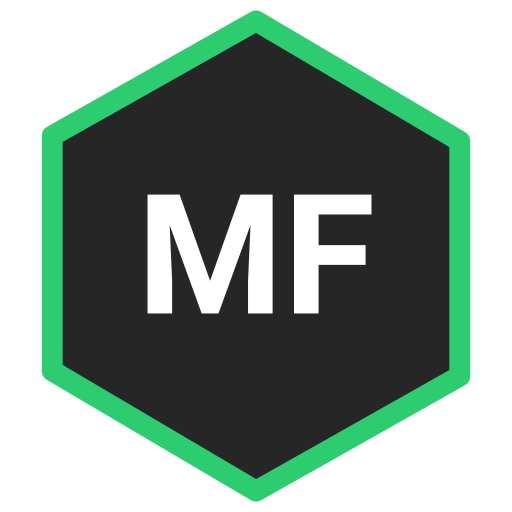

<div align="center">
  
</div>
<h1 align="center">
  Massimiliano Favetta — Personal Portfolio
</h1>
<p align="center">
  Personal engineering portfolio built with <a href="https://www.gatsbyjs.com/" target="_blank">Gatsby v5</a>, <a href="https://react.dev/" target="_blank">React 18</a> &amp; <a href="https://www.framer.com/motion/" target="_blank">Framer Motion</a>, hosted on <a href="https://BodePhase.github.io" target="_blank">GitHub Pages</a>.
</p>

---

## 🛠️ Tech Stack & Architecture

- **Framework:** Gatsby v5 & React 18
- **Styling:** Styled Components (Cyber-Glass dark theme & responsive blueprint grid)
- **Animations:** Framer Motion
- **Interactive Shell:** Custom Hero bash terminal (`neofetch`, `whoami`, `skills`, `chess`, `projects`, `Tab` autocomplete & command history)
- **Runtime:** Node.js v20 LTS

---

## 🚀 Local Development Setup

1. **Use Node.js 20 LTS via NVM:**
   ```bash
   nvm use 20
   ```

2. **Install dependencies:**

   npm install --legacy-peer-deps


3. **Start the development server:**

   ```bash
   npm start
   ```
   Open http://localhost:8000 in your browser.

4. **Production build:**

   ```bash
   npm run build
   ```