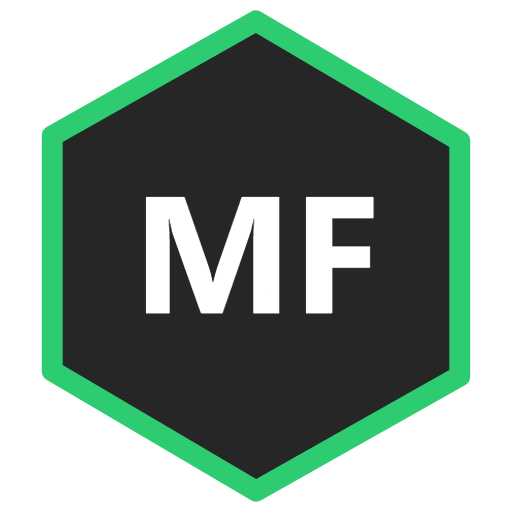
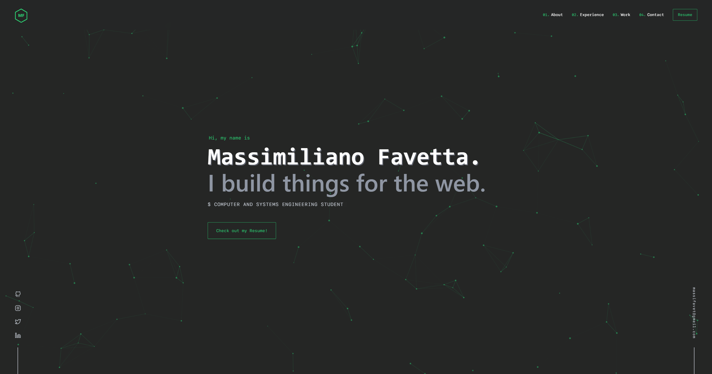

<div align="center">
  
</div>
<h1 align="center">
  massimilianofavetta.com
</h1>
<p align="center">
  Personal portfolio of <strong>Massimiliano Favetta</strong> — Computer and Systems Engineering student at <strong>Sapienza University of Rome</strong>.
</p>



# Massimiliano — Personal Portfolio

Welcome to the repository of my personal portfolio website, built with **Gatsby** and **React**. 

I am a **Computer and Systems Engineering** student at **Sapienza University of Rome**, passionate about software architecture, cybersecurity, and strategic problem-solving. This site showcases my main engineering projects, technical skills, and academic journey.

🌐 **Live Site:** [BodePhase.github.io](https://BodePhase.github.io)

---

## 🛠️ Tech Stack

- **Framework:** [Gatsby v3](https://www.gatsbyjs.com/) & [React](https://reactjs.org/)
- **Styling:** [Styled Components](https://styled-components.com/)
- **Data Layer:** [GraphQL](https://graphql.org/) & Markdown
- **Animations:** [Anime.js](https://animejs.com/) & ScrollReveal

---

## 🚀 Local Development Setup

This project runs on **Node.js v16.20.2** (configured via `.nvmrc`). To run it locally on Linux / WSL2:

1. **Clone the repository:**
   ```bash
   git clone [https://github.com/BodePhase/BodePhase.github.io.git](https://github.com/BodePhase/BodePhase.github.io.git) portfolio
   cd portfolio

2. **Switch to the required Node version via NVM:**
   ```bash
   nvm install 16.20.2
   nvm use

3. **Install dependencies:**
   ```bash
   npm install --legacy-peer-deps

4. **Start the development server:**
   ```bash
   npm start
   The site will be available at http://localhost:8000.